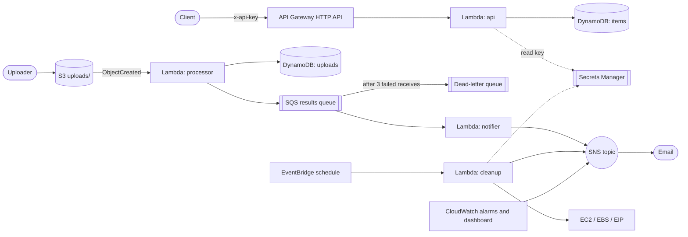

# Serverless Event-Driven App on AWS

An event-driven backend built only from serverless services and deployed with
**CloudFormation** and **GitHub Actions (OIDC, no stored AWS keys)**.

## What it does

| Flow | Path |
|------|------|
| REST API | Client -> API Gateway (HTTP API) -> Lambda -> DynamoDB. Needs an `x-api-key` header checked against **Secrets Manager** |
| File pipeline | Upload to `uploads/` in S3 -> Lambda (counts lines, stores result in DynamoDB) -> SQS -> Lambda -> SNS email |
| Cost hygiene | EventBridge schedule -> Lambda that reports idle EC2 (tag `AutoStop=true`), unattached EBS volumes and unused Elastic IPs; optionally stops the idle instances |
| Observability | JSON structured logs, CloudWatch dashboard, alarms for Lambda errors, API 5xx and dead-letter queue, all alerting through SNS |

## Architecture



## Repository layout

```
template.yaml               main CloudFormation stack
bootstrap/github-oidc.yaml  one-time: OIDC provider, deploy role, artifact bucket
src/api, processor, notifier, cleanup   Lambda code (Python 3.12, arm64)
tests/test_lambdas.py       unit tests using moto (no AWS account needed)
scripts/                    deploy.sh, test_flow.sh, teardown.sh
.github/workflows/deploy.yml   lint + test on PRs, deploy on push to main
```

## Prerequisites

* AWS account with a **billing alarm** already set up
* AWS CLI v2 configured (`aws configure`) in WSL/Ubuntu
* Python 3.12, git, a GitHub account

## Option A: deploy manually

```bash
python3 -m venv .venv && source .venv/bin/activate
pip install -r requirements-dev.txt
pytest -q
cfn-lint template.yaml --ignore-checks W3002
```

```bash
export ALERT_EMAIL=you@example.com
./scripts/deploy.sh
```

Confirm the SNS subscription email, then:

```bash
./scripts/test_flow.sh
```

## Option B: deploy through GitHub Actions (OIDC)

1. Push this repo to GitHub (branch `main`).
2. Deploy the bootstrap stack once from your terminal:

```bash
aws cloudformation deploy \
  --template-file bootstrap/github-oidc.yaml \
  --stack-name serverless-demo-bootstrap \
  --capabilities CAPABILITY_NAMED_IAM \
  --parameter-overrides GitHubOrg=<your-github-username> GitHubRepo=<repo-name> ProjectName=serverless-demo
```

If the account already has the GitHub OIDC provider, add `CreateOIDCProvider=false`.

3. Read the two outputs:

```bash
aws cloudformation describe-stacks --stack-name serverless-demo-bootstrap \
  --query "Stacks[0].Outputs" --output table
```

4. In GitHub open Settings, Secrets and variables, Actions, tab Variables, and add:
   `AWS_ROLE_ARN`, `ARTIFACT_BUCKET`, `ALERT_EMAIL`.
5. Push any commit to `main`. The workflow lints, tests, packages and deploys, then smoke-tests `/health`.

## Using the API

```bash
API_URL=<ApiUrl output>
API_KEY=$(aws secretsmanager get-secret-value --secret-id serverless-demo/app-secrets \
  --query SecretString --output text | python3 -c 'import sys,json; print(json.load(sys.stdin)["api_key"])')
```

```bash
curl -X POST "$API_URL/items" -H "x-api-key: $API_KEY" -H "Content-Type: application/json" \
  -d '{"name":"demo","description":"hello"}'
curl "$API_URL/items" -H "x-api-key: $API_KEY"
```

| Method | Path | Auth | Result |
|--------|------|------|--------|
| GET | /health | none | 200 |
| POST | /items | key | 201 with the new item |
| GET | /items | key | up to 50 items |
| GET | /items/{id} | key | item or 404 |
| DELETE | /items/{id} | key | 204 or 404 |

## Trying the cleanup Lambda safely

It starts in **dry-run** mode (`CleanupDryRun=true`), so it only reports.
To see it flag an idle instance, tag a small EC2 instance `AutoStop=true` and invoke the function from `scripts/test_flow.sh`.
Redeploy with `CleanupDryRun=false` only when you are comfortable it may stop tagged instances.

## Optional: webhook notifications

The secret also holds a `webhook_url` field (empty by default). Put a Slack or Teams incoming-webhook URL in it and the cleanup Lambda posts its report there too.

```bash
aws secretsmanager put-secret-value --secret-id serverless-demo/app-secrets \
  --secret-string '{"api_key":"<keep the existing value>","webhook_url":"https://hooks.slack.com/services/XXX"}'
```

## Cost and clean-up

Everything is pay-per-use and sits inside the free tier for demo traffic. The only fixed charge is the secret (about $0.40 per month).

```bash
./scripts/teardown.sh
```

If you used Option B, also delete the bootstrap stack:

```bash
aws cloudformation delete-stack --stack-name serverless-demo-bootstrap
```

## Troubleshooting

* **Stack fails creating the secret with "already scheduled for deletion"**: a previous stack with the same name left it in the recovery window. `teardown.sh` removes it with `--force-delete-without-recovery`.
* **AccessDenied in the GitHub deploy job**: the role policy in `bootstrap/github-oidc.yaml` is scoped to this project's resources. Read the error, add the missing action, and redeploy the bootstrap stack.
* **No emails**: check the spam folder and confirm the SNS subscription link.
* **Test a failed message path**: send a message with a non-JSON body to the results queue and watch it move to the dead-letter queue and trigger the alarm.

## Design decisions to talk about in interviews

* One IAM role per Lambda with least privilege; EC2 stop is limited by a resource-tag condition.
* No secrets in code or environment variables; the API key is generated by Secrets Manager and cached for 5 minutes.
* SQS between processor and notifier decouples the steps, with partial batch failure reporting and a dead-letter queue.
* OIDC removes long-lived AWS keys from GitHub; the trust policy only allows the `main` branch of this repo.
* Cleanup defaults to dry-run and only flags (never deletes) volumes and IPs.

## Resume bullet

Designed a serverless event-driven system (API Gateway, Lambda, DynamoDB, SQS, SNS, EventBridge) deployed with CloudFormation and GitHub Actions OIDC; secured API access with Secrets Manager and automated AWS idle-resource reporting with Python.

> The stack was deployed through GitHub Actions with OIDC, tested, and then destroyed to avoid AWS charges. Follow the steps above to redeploy.
